<!-- ═════════════ HEADER ═════════════ -->

  

<h1 align="center">Hi, I'm Sonu Kumar Singh</h1>

<h3 align="center">Mobile Platform Engineer &nbsp;|&nbsp; Native Android Developer &nbsp;|&nbsp; Flutter Developer &nbsp;|&nbsp; Kotlin &nbsp;|&nbsp; Dart</h3>

  
  &nbsp;
  

<!-- ═════════════ SOCIAL LINKS ═════════════ -->

  
  
  
  
  
  

  

<!-- ═════════════ 01 · ABOUT ═════════════ -->

  

<table align="center">
  <tr>
    <td valign="middle">
      <ul>
        <li>Native <b>Android Developer</b> focused on <b>Kotlin</b></li>
        <li>Building modern Android applications with <b>Jetpack Compose</b></li>
        <li>Exploring <b>Flutter &amp; Dart</b> for cross-platform development</li>
        <li>Experienced with <b>MVVM, Clean Architecture &amp; Dependency Injection</b></li>
        <li>Working with <b>Firebase, REST APIs &amp; Room Database</b></li>
        <li>Ask me about <b>Android, Kotlin, Flutter &amp; Frontend</b></li>
        <li>Reach me at <a href="mailto:sonusinghsengar28@gmail.com"><b>sonusinghsengar28@gmail.com</b></a></li>
        <li>Fun fact: <i>I think I am funny</i> 😄</li>
      </ul>
    </td>
    <td valign="middle" align="center">
      
    </td>
  </tr>
</table>

 

<!-- ═════════════ 02 · STACK ═════════════ -->

  

  

  
  
  
  
  

  
  
  
  
  

  
  
  

  

<!-- ═════════════ 03 · CONTRIBUTION CALENDAR ═════════════ -->

  

  

 

<!-- ═════════════ 04 · ENGINEERING STATS ═════════════ -->

  

<table align="center">
  <tr>
    <td align="center">
      
    </td>
    <td align="center">
      
    </td>
  </tr>
</table>

 

<!-- ═════════════ 05 · CONSISTENCY STREAK ═════════════ -->

  

  

  

<!-- ═════════════ 06 · COMMIT ACTIVITY ═════════════ -->

  

  

 

<!-- ═════════════ 07 · CONTRIBUTION GRID (SNAKE) ═════════════ -->

  

  <picture>
    <source media="(prefers-color-scheme: dark)" srcset="https://raw.githubusercontent.com/Sonu-kumar-singh-28/Sonu-kumar-singh-28/output/github-contribution-grid-snake-dark.svg" />
    <source media="(prefers-color-scheme: light)" srcset="https://raw.githubusercontent.com/Sonu-kumar-singh-28/Sonu-kumar-singh-28/output/github-contribution-grid-snake.svg" />
    
  </picture>

 

<!-- ═════════════ 08 · PROFILE METRICS ═════════════ -->

  

  

 
 

<!-- ═════════════ CLOSING · SIGNATURE ═════════════ -->

  

  

<!-- ═════════════ CLOSING · CONTACT ═════════════ -->

<h3 align="center">Let's connect</h3>

  
  
  

  

